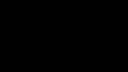


<!-- more -->

 
 

Hello hello, good friends! Welcome back to another underwhelming appointment with Stone Ocean's Blu-Ray/TV comparisons. Are we going to have some differences today? Yes! Are they going to be interesting? Uhhhhhhhhhhhhh anyway!

 

Enough waffling about, let's dive right in!

 

- This HAS GOT TO BE this entire blog's single smallest, most inconsequential change - in the Netflix version of this scene, there was a small white dot (that presumably belonged to Jolyne's layer) that was drawn where it shouldn't be. It's really, really, really small, but you can see it to the right of Jolyne's face, more or less above the prison door. Crazy, I know, but take a look:

 
 

 

- And here, during the mid-episode stand eyecatch, they corrected Viviano's Japanese spelling from ヴィヴィアーノ (which, to be honest, is a spelling that makes perfect sense) to ヴィヴァーノ (read "Vivano", which... doesn't make as much sense as the previous spelling, but is *apparently* the correct one, at least according to the Jojo wiki. Who knew!):

 
 

 

And that's it for this episode! Phew! Wasn't that a blast! And they say we don't know how to have fun here over at Jojo's Bizarre Comparisons... In any case, short as it may be, this concludes our look at Episode #16. Next time we'll take a look at the first part of one of the most divisive fights in the whole of Jojo - "Enter the Dragon's Dream"!

 

If you're reading these posts as they're being posted, this is going to be the last one I'm uploading as part of this chunk of episodes, but I'll be back soon with the rest, don't you fret! And if you're reading these posts from the future... well, just go look at the next episodes, and let me know if there's anything worth comparing! And if you're reading these posts from the past... how are you doing it? Also, boy do you have some interesting years ahead of you!

 

Byeee!

 

